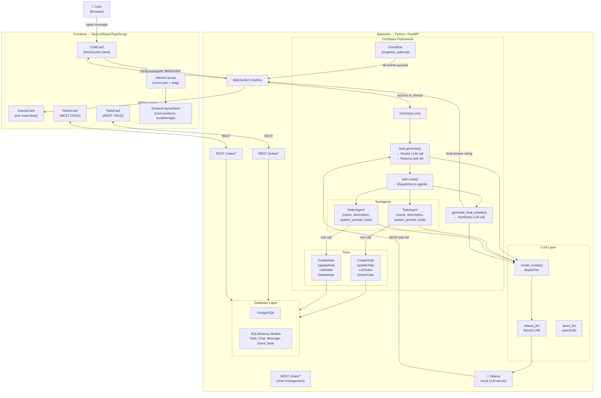
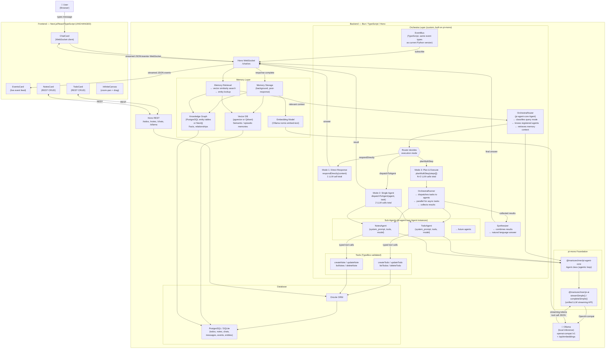
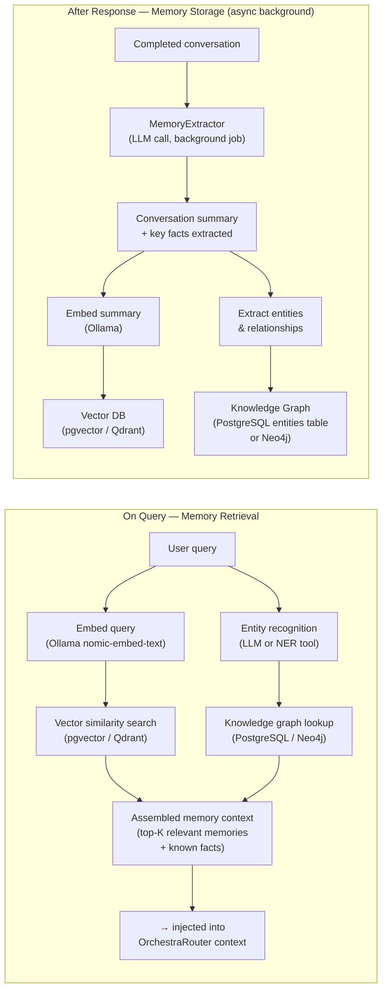
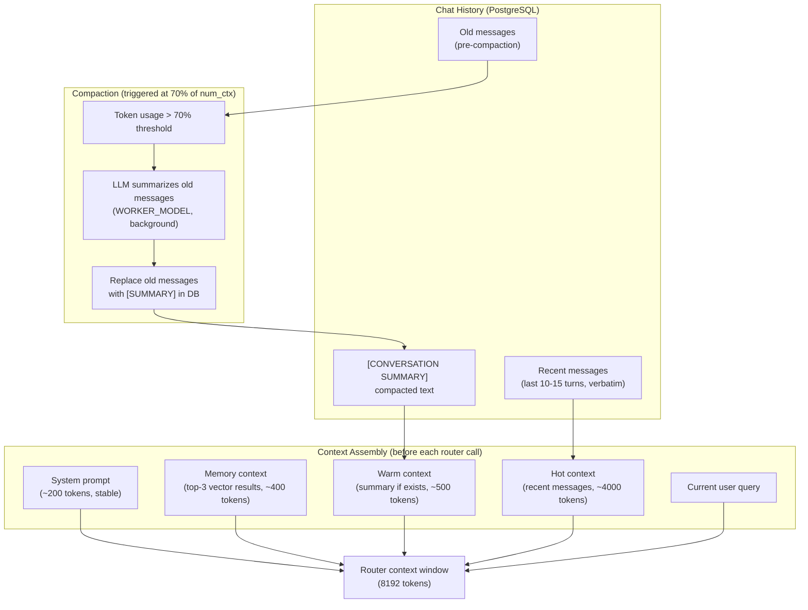

# REFACTOR.md — Doba Project: Deep Analysis, Current State & Rewrite Plan

> **Purpose of this document:** Strategic analysis of the current system, decision rationale for the TypeScript rewrite, and a complete technical reference so that a new AI assistant in a fresh project can understand both the current Python system and the target TypeScript system without reading the source code from scratch.
>
> Written after a full audit of the codebase (backend + frontend) and a deep analysis of the pi-mono framework.

---

## 0. Project Vision (Context for Any Reader)

**Doba / JARVIS** is a 100% local personal AI system — a JARVIS-style assistant that helps with daily life. It is the 6th version of a 4-year project, evolving from keyword-based STT to full agent orchestration.

**Core vision:**
- 100% local (Ollama LLMs, local databases, no cloud required)
- Infinite dashboard with draggable AI-powered widgets (chat, todos, notes, calendar, etc.)
- AI agents that can interact with those widgets the same way the user can
- Extensible: adding a new capability = adding an agent + tools + a card
- Long-term: IoT control, RAG over personal documents, voice commands, mobile companion

**Current working demo:** Ask in the chat "add buy milk to my todo list" → the router LLM generates a task plan → routes to the TodoAgent → agent calls the create_todo tool → the item appears in the TodoCard. The entire event chain (task generation, agent start, tool selection, tool execution, final answer) is visible in real-time in the EventsCard.

---

## 1. Current System: How It Works

### 1.1 Technology Stack

| Layer | Technology |
|---|---|
| Backend framework | FastAPI (Python) |
| ORM | SQLAlchemy |
| Database | PostgreSQL |
| LLM runtime | Ollama (local) |
| Models | llama3.1:8b-instruct-q4_0 (router/worker), qwen3:8b (reasoning) |
| Frontend framework | Next.js (React + TypeScript) |
| Styling | Tailwind CSS + shadcn/ui |
| Canvas | react-zoom-pan-pinch + @dnd-kit/core |
| State | Zustand (persist middleware) |
| Real-time | WebSocket (FastAPI ↔ React) |

### 1.2 Directory Structure (Source Files Only)

```
doba-project/
├── backend/
│   ├── orchestra/               # Custom AI orchestration framework
│   │   ├── __init__.py          # run() entry point
│   │   ├── config.py            # Model names, env vars
│   │   ├── core/
│   │   │   ├── agent.py         # BaseAgent, ToolAgent (plan-and-execute)
│   │   │   ├── task.py          # task.generate(), task.route(), generate_final_answer()
│   │   │   ├── tools.py         # Tool base class (auto schema from type hints)
│   │   │   ├── events.py        # EventBus singleton + EventType enum
│   │   │   ├── retry.py         # RetryConfig, @with_retry, retry_with_correction
│   │   │   └── context.py       # OrchestraContext, ChatMessage, MessageRole
│   │   └── llm/
│   │       ├── base.py          # model_invoke() dispatcher
│   │       ├── ollama_llm.py    # Ollama adapter (JSON response parsing)
│   │       ├── qwen_llm.py      # Qwen3 adapter (<think> tag handling)
│   │       └── deepseek_llm.py  # DeepSeek adapter
│   ├── agents/
│   │   └── personal/
│   │       ├── todo_agent.py    # ToolAgent for todo operations
│   │       └── notes_agent.py   # ToolAgent for notes operations
│   ├── tools/
│   │   └── personal/
│   │       ├── todo_tools.py    # CreateTodo, UpdateTodo, ListTodos, DeleteTodo
│   │       └── notes_tools.py   # CreateNote, UpdateNote, ListNotes, DeleteNote
│   ├── agents/
│   │   └── agent_list.py        # [TodoAgent(), NotesAgent()] — registry
│   ├── api/
│   │   └── routes/
│   │       ├── chat.py          # WebSocket /chat/ws + POST /chat/
│   │       ├── chat_management.py # CRUD for chats (list, create, delete, rename)
│   │       ├── todo.py          # REST CRUD for todos
│   │       ├── notes.py         # REST CRUD for notes
│   │       └── ollama_stats.py  # Ollama health, model info, load/unload
│   ├── db/
│   │   ├── database.py          # SQLAlchemy engine + get_db()
│   │   ├── models.py            # Todo, Chat, Message, Event, Note ORM models
│   │   ├── chat.py              # ChatRepository (queries + schemas)
│   │   ├── todo.py              # TodoRepository
│   │   └── notes.py             # NotesRepository
│   └── server.py                # FastAPI app + CORS + exception handlers
│
└── frontend/
    ├── app/
    │   ├── layout.tsx            # Root layout
    │   └── page.tsx              # Entry point (renders AppShell)
    ├── components/
    │   ├── canvas/
    │   │   ├── InfiniteCanvas.tsx # Main canvas (TransformWrapper + DndContext)
    │   │   └── CardWrapper.tsx    # Draggable wrapper for each card
    │   ├── cards/
    │   │   ├── ChatCard.tsx       # WebSocket chat UI (chat history, events display)
    │   │   ├── EventsCard.tsx     # Live event feed from orchestra
    │   │   ├── TodoCard.tsx       # Todo CRUD widget
    │   │   ├── NotesCard.tsx      # Notes CRUD widget
    │   │   └── OllamaStatsCard.tsx # Ollama model stats
    │   ├── layout/
    │   │   ├── AppShell.tsx       # Root shell (sidebar + canvas)
    │   │   └── AppSidebar.tsx     # Sidebar (add card buttons, navigation)
    │   └── ui/                    # shadcn/ui components
    ├── stores/
    │   └── layoutStore.ts         # Zustand store: card positions, sizes, zIndex
    └── contexts/
        └── OrchestraContext.tsx   # React context for orchestra events
```

### 1.3 How a Chat Message Flows (Current System)

This is the complete flow from the user pressing Enter in the ChatCard to the final answer appearing:

```
1. User types message → ChatCard sends JSON over WebSocket
   { "message": "add buy milk to my todo list" }

2. FastAPI WebSocket handler (chat.py)
   - Saves user message to DB (Message table)
   - Emits "log" event → frontend receives it → shows "Received query: ..."
   - Calls asyncio.to_thread(run, query, agent_list, chat_history)
     (orchestra.run() is synchronous, so it runs in a thread)

3. orchestra.run() → task.generate(user_message, agent_list, history)
   - Builds system prompt with list of available agents (name + description)
   - Calls model_invoke() with router model (llama3.1:8b)
   - LLM returns JSON: { "steps": [ { "step_number": 1, "task": "...", "agent": "todo_agent", ... } ] }
   - Emits EventType.TASK_GENERATION_START / TASK_GENERATION_END

4. task.route(task_list, agent_list) → iterates task steps
   - For each step: finds the named agent in agent_list
   - Calls agent.execute(AgentTask(task=..., expected_output=...))
   - Emits EventType.TASK_START

5. ToolAgent.execute(task) — the core of orchestra
   - Builds a prompt: "you have these tools, pick ONE, return JSON with tool_name + tool_args"
   - Calls model_invoke() with worker model
   - Parses response (with retry_with_correction if JSON is malformed)
   - Emits EventType.TOOL_SELECTION
   - Calls selected_tool.run(**tool_args)
   - Emits EventType.TOOL_START / TOOL_END
   - Returns { result, tool_used, reasoning, arguments }
   - Emits EventType.AGENT_END

6. task.generate_final_answer(original_message, results)
   - Formats all task results into a single prompt
   - Calls model_invoke() → gets synthesized natural language response
   - Returns final answer string

7. Back in chat.py WebSocket handler
   - Saves assistant response to DB
   - Adds to OrchestraContext (in-memory conversation history)
   - The event_listener thread is forwarding all EventBus events to the WebSocket queue

8. Frontend (ChatCard.tsx)
   - Receives events in real-time: task_generation_start, task_start, tool_selection, tool_start, tool_end, orchestra_end
   - "orchestra_end" event contains final_answer → renders it as markdown
   - "tool_start" events → renders "Executing: {tool_name}..." inline
```

### 1.4 System Architecture Diagram (Current)



### 1.5 Data Models (Current PostgreSQL Schema)

```
Todo          { id, title, description, status: idle|in_progress|completed }
Chat          { id, title, created_at, updated_at }
Message       { id, chat_id→Chat, role: user|assistant|system, content, created_at }
Event         { id, chat_id→Chat, type, source, data:JSON, timestamp }
Note          { id, title, content, tags, created_at, updated_at }
```

### 1.6 EventBus Event Types (Current)

These events are emitted by orchestra during processing and streamed over WebSocket to the frontend in real-time:

```
ORCHESTRA_START / ORCHESTRA_END
TASK_GENERATION_START / TASK_GENERATION_END
TASK_START / TASK_COMPLETE / TASK_ERROR
AGENT_START / AGENT_END
TOOL_SELECTION / TOOL_START / TOOL_END / TOOL_ERROR
RETRY
LOG
```

Each event has: `{ type, source, data: {}, timestamp }`

### 1.7 Agent Registration Pattern (Current)

Agents are registered as a flat list. The router LLM receives each agent's `name` + `description` to build the task plan:

```python
agent_list = [
    TodoAgent(),    # name="todo_agent", description="Manages todo items..."
    NotesAgent(),   # name="notes_agent", description="Manages notes..."
]
```

Each `ToolAgent` holds:
- `name` — used by the router to route tasks
- `description` — shown to the router LLM for selection
- `system_prompt` — injected into the agent's own LLM call
- `tools` — list of `Tool` instances available to this agent
- `model` — which LLM to use

---

## 2. Core Problems With the Current System

### Problem 1: No Real Agentic Loop

`ToolAgent.execute()` makes ONE LLM call, picks ONE tool, runs it, and is done. There is no feedback loop. An agent cannot observe the result of a tool call and decide to call another tool. The router must do all the planning upfront, which is fragile for complex tasks.

### Problem 2: Everything Is Synchronous

The entire orchestra pipeline is synchronous Python. `asyncio.to_thread(run, ...)` in `chat.py` is the workaround — orchestra runs in a thread pool. This means: no true parallelism for independent tasks, no response streaming, blocking worker threads during long LLM calls.

### Problem 3: Brittle JSON Tool Calling

Tool calling is implemented via prompt engineering: "here are your tools, return JSON with tool_name and tool_args." The model frequently returns malformed JSON or deviates from the format. The codebase has 50+ lines of fallback logic: `retry_with_correction`, parameter name matching, single-tool fallback. Different models (Qwen vs Llama) return different formats. This is an ongoing maintenance burden.

### Problem 4: No Memory

Agents are stateless. The router receives chat history, but individual agents receive only a task string. No agent knows what happened in previous sessions, what other agents did in the same session, or anything about the user's persistent context.

### Problem 5: No Streaming

Users wait for the complete response before seeing anything. There is no token-by-token streaming. All three LLM calls (task generation, agent execution, final synthesis) must complete before any text reaches the frontend.

---

## 3. The Rewrite Decision

### Decision: Full TypeScript Rewrite

**Stack decided:**
- **Runtime:** Bun (fast, all-in-one: runtime + package manager + bundler + test runner)
- **HTTP/WebSocket server:** Hono (lightweight, first-class Bun support, native WebSocket)
- **Agent foundation:** pi-mono (`@mariozechner/pi-ai` + `@mariozechner/pi-agent-core`)
- **Database ORM:** Drizzle ORM
- **Database:** PostgreSQL (same as current) or SQLite for local simplicity
- **Frontend:** unchanged (Next.js/React/TypeScript)

**Why TypeScript + Bun:**
- Frontend is already TypeScript — shared types across the stack, no duplication of data models
- Bun is faster than Node.js, has native SQLite, and replaces npm/webpack with a single tool
- TypeScript is async-first by nature — no `asyncio.to_thread` hacks needed
- Single language for the entire project reduces context switching

**Why pi-mono:**
- `pi-ai`: production-quality unified LLM streaming API. Handles SSE parsing, tool call streaming, thinking tags, cross-provider normalization. Replaces the fragile `ollama_llm.py` / `qwen_llm.py` adapters.
- `pi-agent-core`: proper agentic loop — the `Agent` class runs LLM → tool call → observe → LLM → loop until stop. Solves Problem 1 above.
- TypeBox schemas for tools: structured, validated tool arguments. Solves Problem 3 (no more prompt-engineered JSON parsing).

**What pi-mono does NOT provide (must be built):**
- Multi-agent orchestration (router, task planning, agent dispatch) — this is YOUR architecture, built on top of the `Agent` primitive (see Section 4.2)
- HTTP/WebSocket server — Hono handles this
- Database/persistence — Drizzle handles this
- Ollama auto-discovery — define models manually via `openai-completions` adapter pointing to `http://localhost:11434/v1` (see Section 9)
- Memory / RAG — built custom, phased approach (see Section 8)

---

## 4. Target Architecture

### 4.1 How pi-mono's Agent Works (Key Concept)

The `Agent` class from `@mariozechner/pi-agent-core` replaces `ToolAgent`:

```
agent.prompt("do something") →
  LLM call with tools available →
    if LLM calls a tool:
      validate args (TypeBox) →
      execute tool.execute() →
      result appended to context →
      loop back to LLM call →
    if LLM stops:
      emit "agent_end" event →
      done
```

This is the real agentic loop. Each sub-agent can now reason, use multiple tools, correct itself, and complete multi-step sub-tasks autonomously.

### 4.2 How Multi-Agent Orchestration Works on Top of pi-mono

pi-mono has NO built-in router or multi-agent concept. The orchestration layer is built from scratch, preserving orchestra's plan-and-execute design with one important improvement: **not all queries need the full plan-and-execute pipeline.**

#### 4.2.1 Query Classification — The Four Execution Modes

The current Python orchestra always runs the full pipeline regardless of query complexity. This adds 2-3 unnecessary LLM calls for simple requests. The TypeScript system introduces a classification step as the router's first decision.

The `OrchestraRouter` is a pi-agent-core `Agent` whose FIRST tool call classifies the query and determines the execution path. It has four tools available:

**Mode 1 — Direct Response** (`respondDirectly`)
> Used when: no tools or agents are needed. The LLM can answer from its own knowledge.
> Examples: "what's the capital of France?", "explain this error message", "hello, how are you?", "what can you do?", conversational small talk, general knowledge questions.
> Cost: 1 LLM call (router classifies + generates answer in one step)
> Flow: `query → router → respondDirectly(content) → stream to user`

**Mode 2 — Single Agent Dispatch** (`dispatchToAgent`)
> Used when: the query clearly belongs to exactly one agent, no planning required.
> Examples: "show me my todos", "add milk to shopping list", "create a note about today's meeting", "what are my notes tagged with work?".
> Cost: 1 router LLM call + 1 agent execution (with its own agentic loop)
> Flow: `query → router → dispatchToAgent(agent, task) → agent runs → result to user`

**Mode 3 — Full Plan-and-Execute** (`planMultiStep`)
> Used when: the query requires coordination between multiple agents with INDEPENDENT tasks that don't depend on each other's results.
> Examples: "summarize my notes and create action item todos", "list my todos and create a note summarizing them".
> Cost: 1 router LLM call (planning) + N agent LLM calls + 1 synthesis LLM call
> Flow: `query → router → planMultiStep(steps[]) → OrchestraRunner → agents → synthesis → user`
> Note: Sequential steps receive context from previous step results, so later agents can reference earlier results.

**Mode 4 — Adaptive Orchestration** (`callAgentAndObserve`)
> Used when: the query involves conditional logic, result-dependent decisions, or data inspection before acting. The router executes agents one at a time, observes results, reasons about them, and decides the next action — all within its own agentic loop.
> Examples: "check my todos, if there's one about project X mark it done, otherwise create it", "what notes and todos do I have? if I have a todo about phase 4, mark it complete, if not create one and mark it complete".
> Cost: 1+ router LLM calls (interleaved with agent executions) + N agent executions
> Flow: `query → router → callAgentAndObserve(agent, task) → observe result → reason → callAgentAndObserve(agent, next task) → ... → respondDirectly(final answer) → user`

This classification happens naturally inside the router agent's own agentic loop — there is no separate classifier LLM call. The router is given the query, the available agents, and context from memory, and it picks which tool to call first. This is the key insight: classification IS the planning.

```
Query: "add milk to my shopping list"
→ Router sees TodoAgent is available
→ Router calls dispatchToAgent("todo_agent", "add item 'milk' to the shopping list")
→ TodoAgent runs its agentic loop with createTodo tool
→ Done. 2 total LLM calls instead of 4.

Query: "what is 2 + 2"
→ Router sees no agent is relevant
→ Router calls respondDirectly("4")
→ Done. 1 total LLM call.

Query: "summarize my notes from this week and create todos for any action items"
→ Router identifies 2 agents needed (NotesAgent, TodoAgent)
→ Router calls planMultiStep([{ agent: "notes_agent", task: "..." }, { agent: "todo_agent", task: "..." }])
→ OrchestraRunner dispatches to each agent sequentially (later steps receive earlier results as context)
→ Synthesis step combines results
→ Done. Full pipeline.

Query: "check my todos, if there's one about phase 4 mark it done, otherwise create it"
→ Router calls callAgentAndObserve("todo_agent", "list all todos")
→ Router receives the todo list, sees no phase 4 todo
→ Router calls callAgentAndObserve("todo_agent", "create a todo called 'code phase 4' and mark it complete")
→ Router calls respondDirectly("I checked your todos and didn't find one about phase 4, so I created 'code phase 4' and marked it complete.")
→ Done. Conditional logic handled naturally.
```

#### 4.2.2 Full Orchestration Components

1. **OrchestraRouter** — a pi-agent-core `Agent` with four dispatch tools (`respondDirectly`, `dispatchToAgent`, `planMultiStep`, `callAgentAndObserve`) and access to the agent registry (names + descriptions). Receives: user query + chat history + memory context. Emits: `TASK_GENERATION_START/END` events. This replaces `task.generate()`. Includes retry logic: if the router fails to call any tool on first attempt, it retries with a nudge prompt. Tools are created per-request as closures over a `RouterState` object to avoid shared mutable state between concurrent requests.

2. **OrchestraRunner** — receives a task list from the `planMultiStep` tool call, dispatches each task to the corresponding `Agent` instance by name, collects results in order. This replaces `task.route()`. For independent tasks with `is_async: true`, can dispatch in parallel using `Promise.all`.

3. **Sub-agents** (TodoAgent, NotesAgent, etc.) — each is an `Agent` instance with its own system prompt, model, and TypeBox-defined tools. They run their own full agentic loop (multi-step, can call multiple tools, can self-correct).

4. **Final synthesis** — a dedicated lightweight `Agent` (or direct LLM call) that combines results from multiple sub-agents into a coherent natural language answer. Only triggered in Mode 3. This replaces `generate_final_answer()`.

### 4.3 Target Architecture Diagram



### 4.4 Mapping: Orchestra Concepts → TypeScript Equivalents

| Orchestra (Python) | TypeScript equivalent | Notes |
|---|---|---|
| `ToolAgent.execute()` | `agent.prompt()` (pi-agent-core) | Now runs a real agentic loop |
| `task.generate()` | Router `Agent`'s tool call | TypeBox-validated, same idea |
| `task.route()` | `OrchestraRunner.dispatch()` | Calls sub-agent instances |
| `generate_final_answer()` | Synthesis turn in Router or dedicated Agent | |
| `EventBus` singleton | TypeScript `EventBus` class | Same event types, same payload shape |
| `EventType` enum | TypeScript `const EventType` | Exact same event names |
| `model_invoke()` | `pi-ai` `completeSimple()` / `streamSimple()` | Handles all models uniformly |
| `Tool.get_schema()` | TypeBox `Type.Object(...)` | Validated by AJV automatically |
| `tool.run(**kwargs)` | `tool.execute(toolCallId, params, signal)` | params are typed via TypeBox |
| `agent_list = [...]` | `agentRegistry: Map<string, Agent>` | Same concept, name → agent instance |
| `RetryConfig` / `@with_retry` | pi-ai `RetryOptions` in AgentOptions | Built into the Agent class |
| `retry_with_correction` | Not needed | TypeBox validation + native tool calling eliminates this |
| `OrchestraContext` | `Drizzle` chat history queries | Persistent, not in-memory |

### 4.5 Target Directory Structure (TypeScript Backend)

```
backend-ts/
├── src/
│   ├── server.ts                # Hono app + routes registration
│   ├── llm/
│   │   └── models.ts            # Ollama model definitions (pi-ai custom model objects)
│   │                            # ROUTER_MODEL, WORKER_MODEL, THINKING_MODEL, EMBEDDING_MODEL
│   ├── orchestra/
│   │   ├── index.ts             # run() entry point — classifies and dispatches
│   │   ├── router.ts            # OrchestraRouter: respondDirectly / dispatchToAgent / planMultiStep
│   │   ├── runner.ts            # OrchestraRunner: dispatches task list, parallel support
│   │   ├── synthesis.ts         # Final answer synthesis (Mode 3 only)
│   │   └── events.ts            # EventBus (same event types as Python version)
│   ├── agents/
│   │   ├── registry.ts          # agentRegistry: Map<string, AgentDefinition>
│   │   └── personal/
│   │       ├── todo-agent.ts    # Agent instance + system prompt + tools
│   │       └── notes-agent.ts   # Agent instance + system prompt + tools
│   ├── tools/
│   │   └── personal/
│   │       ├── todo-tools.ts    # TypeBox-validated tools (createTodo etc.)
│   │       └── notes-tools.ts   # TypeBox-validated tools (createNote etc.)
│   ├── memory/
│   │   ├── index.ts             # Memory facade: retrieve() and store()
│   │   ├── embeddings.ts        # Ollama embedding generation (/api/embeddings)
│   │   ├── vector-store.ts      # Vector similarity search (pgvector or Qdrant client)
│   │   ├── knowledge-graph.ts   # Entity/relationship storage and lookup
│   │   └── extractor.ts         # Post-conversation memory extraction (background job)
│   ├── routes/
│   │   ├── chat.ts              # Hono WebSocket + REST chat endpoints
│   │   ├── todos.ts             # Hono REST todos
│   │   ├── notes.ts             # Hono REST notes
│   │   └── ollama.ts            # Hono REST ollama stats
│   └── db/
│       ├── schema.ts            # Drizzle schema (same tables + memory tables)
│       ├── client.ts            # Drizzle client setup
│       └── repositories/
│           ├── chats.ts
│           ├── todos.ts
│           ├── notes.ts
│           └── memory.ts        # Memory entries, entities, embeddings
├── package.json                 # Bun workspaces
├── bunfig.toml                  # Bun config
└── drizzle.config.ts            # Drizzle migrations config
```

---

## 5. What Stays Exactly the Same

These are preserved verbatim in the rewrite — do not redesign them:

**Event names and payload shape.** The frontend EventsCard and ChatCard are already built around the current event protocol. The TypeScript `EventBus` must emit events with the same `type` string values (e.g. `"tool_start"`, `"orchestra_end"`) and the same `{ type, source, data, timestamp }` envelope. The frontend does not change.

**The agent registration pattern.** A flat collection of named agents. The router receives the list of names + descriptions. Sub-agents are looked up by name. Same concept.

**The plan-and-execute architecture.** Router plans → runners dispatches → agents execute → synthesizer combines. This is the design. pi-mono is the foundation; this is the building on top.

**The WebSocket event streaming.** The frontend connects to `/chat/ws`, sends `{ "message": "..." }`, and receives a stream of JSON events. The contract is identical.

**The REST API routes.** Same endpoints: `/v1/todos`, `/v1/notes`, `/v1/chats`, `/v1/ollama/stats`, etc. Same response shapes. The frontend REST calls don't change.

**The frontend entirely.** The infinite canvas, the cards, the sidebar, the Zustand store, the design system — all unchanged. The only thing the frontend needs is the same API contract.

---

## 6. What Changes and Why

| Current (Python) | New (TypeScript) | Reason |
|---|---|---|
| `asyncio.to_thread(run, ...)` | `await orchestra.run(...)` | Async-first, no thread pool needed |
| Prompt-engineered JSON tool calling | TypeBox schemas + native function calling | No more brittle JSON parsing |
| `retry_with_correction` loop | pi-agent-core built-in retry + TypeBox validation | Handled at framework level |
| 3 separate LLM adapter files | Single `completeSimple()` call | pi-ai handles all model differences |
| `<think>` tag parsing in frontend | `ThinkingContent` in pi-ai message types | Normalized at LLM layer |
| In-memory `OrchestraContext` | Drizzle DB queries for history | Persistent across WebSocket reconnects |
| No context limit handling | Three-tier compaction (hot/warm/cold) | Local models have 4K-16K windows |
| Static LLM call (no streaming) | pi-ai streaming + token usage tracking | Enables compaction trigger + live responses |
| No model preloading | Startup preload with `keep_alive: -1` | KV cache stays warm between requests |
| SQLAlchemy ORM | Drizzle ORM | TypeScript-native, better type inference |
| uvicorn / FastAPI | Hono on Bun | Single runtime, native WebSocket, faster |
| Python venv + pip | Bun (no separate package manager) | Unified toolchain |

---

## 7. Bun-Specific Notes

Bun is the runtime, package manager, bundler, and test runner in one:

```bash
bun install          # package management (replaces npm/yarn)
bun run src/server.ts  # direct TypeScript execution (no tsc step)
bun test             # test runner
bun build            # bundler
```

Bun has native SQLite support (`bun:sqlite`) — an alternative to PostgreSQL for purely local deployments where Docker is not desirable. For this project, starting with Drizzle + PostgreSQL (matching the current setup) is recommended, with the option to switch to Bun SQLite if simplification is needed later.

Bun is compatible with most Node.js packages including `hono`, `drizzle-orm`, and `@mariozechner/pi-ai`.

---

## 8. Memory Architecture

The current system has no memory beyond the active chat session. Every conversation starts blind. The memory system adds two complementary layers: semantic/episodic memory (vector search) and structured/factual memory (knowledge graph). Both are opt-in additions that don't change the core orchestration — memory is injected as context before the router runs, and stored asynchronously after a response is sent.

### 8.1 Memory Types

**Short-term memory (already exists)**
The current chat history stored in PostgreSQL. Passed as context to the router on every message. Limited to the current session window. No changes needed here.

**Semantic / Episodic Memory (vector store)**
What it stores: summaries of past conversations, important user statements, outcomes of actions ("you added 3 todos about project X on March 2nd"), user preferences expressed in natural language ("I prefer dark themes", "I like concise answers").

How retrieval works: when a new query arrives, it's embedded and the top-K most semantically similar past memories are retrieved and injected into the router's context window before planning begins.

Use cases: "what did we talk about last week?", "do you remember I told you about my project?", context carry-over between sessions.

**Structured / Factual Memory (knowledge graph)**
What it stores: named entities (people, projects, places, tools, habits), relationships between them, and explicit user facts ("Felipe works on the Doba project", "Felipe's birthday is March 15").

How retrieval works: entity recognition on the query → lookup entity relationships → inject relevant facts as structured context.

Use cases: multi-hop reasoning ("what projects involve João?"), preference lookup ("how does Felipe like his todos formatted?"), temporal facts.

### 8.2 Architecture



### 8.3 Technology Choices

**Embedding generation:** Ollama `/api/embeddings` endpoint with a dedicated embedding model. Recommended: `nomic-embed-text` (768 dimensions, good semantic quality, fast locally). This means no additional service is needed for embeddings — Ollama handles inference AND embeddings.

**Vector store options (pick one):**

| Option | Infra needed | Best for |
|---|---|---|
| `pgvector` (PostgreSQL extension) | Just enable the extension in existing DB | Simplest. Personal scale (< 100k vectors). Zero new services. Start here. |
| Qdrant | Docker container | When pgvector query performance becomes a bottleneck. Better filtering, HNSW indexing. |
| `vectra` (npm package) | None — stores to local JSON | Prototype only. No Docker, no DB. Easy to start, hard to migrate. |

**Recommendation:** Start with pgvector. It adds a single column type to PostgreSQL with an index. No new infrastructure, no new Docker service. For a personal system that will have thousands (not millions) of memory entries, pgvector is more than adequate.

**Knowledge graph options (pick one):**

| Option | Infra needed | Best for |
|---|---|---|
| PostgreSQL entity tables | Already have PostgreSQL | Sufficient for personal use. Entity → Relationship → Entity with JOIN queries. |
| Neo4j Community | Docker container | When you need complex graph traversals (multi-hop, path finding, community detection). |

**Recommendation:** Start with PostgreSQL entity tables. Two tables: `entities (id, name, type, attributes:JSONB)` and `entity_relationships (from_id, to_id, relationship_type, metadata:JSONB)`. This handles simple fact storage and retrieval. Migrate to Neo4j only if you need true graph query capabilities (Cypher queries, complex traversals).

### 8.4 Memory Integration in the Orchestration Flow

Memory plugs into the orchestration at two points:

**Point 1 — Pre-query (retrieval):**
```
WebSocket receives query
→ Embed the query (Ollama)
→ Vector search: top-3 relevant past memories
→ Entity recognition: extract entities from query
→ Knowledge graph lookup: facts about those entities
→ Assemble memory context string
→ Pass to OrchestraRouter as additional system context
→ Router now has: query + chat history + memory context
```

**Point 2 — Post-response (storage):**
```
Synthesis completes, final answer sent to user
→ Trigger background job (non-blocking)
→ MemoryExtractor LLM call:
    "Given this conversation, extract: 1) a 2-sentence summary, 2) any facts about the user, 3) any entities mentioned"
→ Embed the summary
→ Store summary vector in pgvector
→ Store extracted entities in knowledge graph
```

The background job is fire-and-forget — it does not block the response. If it fails, the user experience is unaffected.

### 8.5 New Database Tables (Memory)

```
memory_entries   { id, summary: text, embedding: vector(768), source_chat_id, created_at }
entities         { id, name: text, type: text, attributes: JSONB, created_at, updated_at }
entity_relations { id, from_entity_id, to_entity_id, relation_type: text, metadata: JSONB, created_at }
```

The `memory_entries.embedding` column requires the `pgvector` PostgreSQL extension and Drizzle's `pgvector` plugin.

### 8.6 Implementation Phases for Memory

**Phase 1 (immediate value, low effort):** Short-term memory improvements — extend chat history to persist across WebSocket reconnects (already done via DB), pass last N messages as context to router.

**Phase 2 (medium effort):** Semantic memory — add pgvector extension, add `memory_entries` table, wire up embedding after each conversation, add vector retrieval before routing. Uses Ollama for embeddings.

**Phase 3 (higher effort):** Knowledge graph — add entity tables, wire up entity extraction in the background job, inject entity facts into router context. Start with PostgreSQL entity tables.

**Phase 4 (optional, if needed):** Migrate vector store to Qdrant and/or graph to Neo4j when PostgreSQL performance becomes a bottleneck.

---

## 9. Local Inference: Ollama, Alternatives, and Model Selection

### 9.1 Is Ollama Still the Right Choice?

pi-mono does not provide a local inference backend. `pi-ai` is provider-agnostic: any OpenAI-compatible API works via the `openai-completions` adapter type with a custom `baseUrl`. The question is which local inference server to point it at.

**Ollama remains the best choice** for this project for these reasons:
- Best-in-class model management: `ollama pull qwen3:8b`, `ollama list`, `ollama rm`, automatic quantization selection
- Runs as a background service with automatic hardware acceleration (CUDA, Metal, ROCm)
- Exposes an OpenAI-compatible API at `http://localhost:11434/v1` — works directly with pi-ai
- Also exposes `/api/embeddings` for embedding generation (needed for memory system)
- Large model catalog covering Qwen, Llama, Mistral, DeepSeek, Gemma, and most relevant local models
- Active community and rapid updates when new models are released

**Other local inference options (all work with pi-ai's `openai-completions` adapter):**

| Option | API URL | Notes |
|---|---|---|
| Ollama | `http://localhost:11434/v1` | Recommended. Best model management. |
| LM Studio | `http://localhost:1234/v1` | Good GUI. Same adapter. Easy swap. |
| llama.cpp server | `http://localhost:8080/v1` | Maximum control. Manual setup. |
| Jan | `http://localhost:1337/v1` | Desktop app. Same adapter. |
| vLLM (via pi-pods) | varies | GPU cluster use. Overkill for personal use. |

**The important implication:** since all these backends expose the same OpenAI-compatible API, switching between them requires changing only the `baseUrl` in `src/llm/models.ts`. The orchestration layer is completely inference-backend agnostic.

### 9.2 Model Roles and Selection

The current Python system uses two models: `llama3.1:8b-instruct-q4_0` (router/worker) and `qwen3:8b` (thinking/reasoning). The TypeScript system should formalize this into four distinct model roles:

| Role | Purpose | Requirements | Suggested model |
|---|---|---|---|
| **Router model** | Query classification, task planning | Fast, reliable tool calling, small context sufficient | Small + tool-calling reliable (4B-8B Q4) |
| **Worker model** | Agent execution, tool use | Reliable tool calling, follows instructions, medium speed | Medium quality-speed balance (7B-9B) |
| **Thinking model** | Complex reasoning, synthesis, ambiguous queries | Extended reasoning, larger context | Larger or reasoning-capable model (8B+ with think tags) |
| **Embedding model** | Memory vector generation | Embedding-specific, not generative | `nomic-embed-text` via Ollama |

**Key principle: the router model matters most.** It runs on every single query. Poor tool-calling reliability in the router means the classification step fails, falling back to full plan-and-execute for everything, defeating the smart routing. Prioritize a model with high tool-calling success rate over raw intelligence for the router role.

**On Qwen models:** The Qwen series has consistently strong tool-calling performance. The 4B variants are notably fast and reliable for structured outputs (router tasks). The 8B+ variants add reasoning quality useful for synthesis and complex agent tasks. The thinking models (with `<think>` tags) are supported natively by pi-ai's `ThinkingContent` message type — no frontend changes needed; the ChatCard already handles `<think>` tags via the existing `parseThinkTags` function.

**Model configuration in code (`src/llm/models.ts`):**
```
ROUTER_MODEL   — fast, reliable tool calling (small, Q4 quant)
WORKER_MODEL   — balanced quality/speed for agent execution
THINKING_MODEL — reasoning-capable for synthesis and complex tasks
EMBEDDING_MODEL — nomic-embed-text or similar
```

Each `Agent` instance accepts a `model` parameter. The `OrchestraRouter` uses `ROUTER_MODEL`. Sub-agents use `WORKER_MODEL` by default, but can be overridden per-agent (e.g., a future `ResearchAgent` might use `THINKING_MODEL`).

### 9.3 Model Switching at Runtime

Because pi-ai model objects are plain TypeScript objects, hot-swapping models requires only updating the object passed to an `Agent` via `agent.setModel()`. A future settings API endpoint could allow changing models without restarting the backend, useful for experimenting with new Ollama model releases.

---

## 10. Context Management & Caching

Local models are the hardest constraint in this entire architecture. A cloud model like Claude or GPT-4 has a 100K-200K context window. Ollama running llama3.1:8b on a local GPU defaults to **4096 tokens** — not because the model only supports that, but because Ollama limits it by default to save VRAM. Even if you bump it to 8K or 16K, a long conversation with tool calls, agent results, and synthesis responses fills up fast.

This section covers two related problems: managing what goes into the context window, and making the inference as fast as possible through caching.

### 10.1 The Two Distinct Context Scopes

Before designing a strategy, it's important to recognize that the Doba orchestration system has **two separate context scopes** that need to be managed independently:

**Scope 1 — Chat history context (router-level)**
The growing conversation between the user and JARVIS, stored in PostgreSQL and passed to the `OrchestraRouter` on every message. This is the one that grows unboundedly and will eventually exceed the context window in long sessions.

**Scope 2 — Agent execution context (agent-level)**
The internal context of a single sub-agent during one orchestration run: its system prompt + the assigned task + tool call results as they accumulate. This is naturally bounded — a typical agent execution involves 2-8 tool calls max before stopping. pi-agent-core manages this internally and its `transformContext` hook is the control point.

The critical insight: **Scope 1 is the real problem. Scope 2 is inherently small.** Most context management work targets the chat history.

### 10.2 Three-Tier Context Model

Rather than a simple rolling window (which abruptly loses context) or unlimited history (which eventually overflows), the system uses a three-tier model:

```
┌────────────────────────────────────────────────────────────┐
│  TIER 1 — HOT CONTEXT                                      │
│  Last N turns (e.g. 10-15 messages)                        │
│  Always included, verbatim. Full fidelity.                 │
│  Sits directly in the context window.                      │
├────────────────────────────────────────────────────────────┤
│  TIER 2 — WARM CONTEXT                                     │
│  Older turns, compressed into a rolling summary.           │
│  "Summary of earlier conversation: [2-3 paragraphs]"      │
│  Keeps semantic meaning without every token.               │
│  Generated by an LLM call when compaction is triggered.   │
├────────────────────────────────────────────────────────────┤
│  TIER 3 — COLD CONTEXT (Long-term memory)                  │
│  Past sessions, retrieved by vector similarity.            │
│  Not always injected — only when semantically relevant.   │
│  Described in Section 8.                                  │
└────────────────────────────────────────────────────────────┘
```

All three tiers are assembled into a context string that gets injected before the router runs on each message. The total size of Tier 1 + Tier 2 + Tier 3 must fit within the context budget.

### 10.3 Context Compaction: When and How

**When to trigger compaction:**

pi-ai returns token usage on every LLM response via `AssistantMessage.usage.inputTokens`. Track cumulative input token counts. Trigger compaction when the chat history reaches **70% of `num_ctx`**. This leaves headroom for:
- The compaction summary itself (~300-500 tokens)
- The next user message + assistant response (~1000-2000 tokens)
- Tool call results if agents are invoked

**How compaction works:**

```
trigger: input tokens > 0.70 × num_ctx

1. Split message history into:
   - [old messages]  — everything except the last 10 turns
   - [recent messages] — last 10 turns (the hot context, kept verbatim)

2. Call the LLM (with WORKER_MODEL):
   "Summarize the following conversation history into 2-3 concise paragraphs,
    preserving all important facts, decisions made, and action items.
    Focus on what would be useful for continuing the conversation."
    + [old messages formatted as text]

3. Replace [old messages] in the DB with a single synthetic message:
   { role: "system", content: "[CONVERSATION SUMMARY]\n" + summary }

4. Mark the chat as having been compacted (flag in DB)

5. Future messages are appended after the recent messages
   (summary → recent messages → new messages)
```

This is triggered at most once per N messages and is transparent to the user — they never see it happen.

**pi-agent-core integration:**

The `Agent` class accepts a `transformContext` function in its options. This is called before each LLM request with the full message array. For the `OrchestraRouter` agent, this is where you implement compaction for the chat history context:

```
transformContext: async (messages) => {
  const tokenEstimate = estimateTokens(messages);
  if (tokenEstimate > COMPACTION_THRESHOLD) {
    return await compactMessages(messages);
  }
  return messages;
}
```

For sub-agents (TodoAgent etc.), the execution context is small enough that compaction is rarely needed. But you can apply the same hook with a higher threshold as a safety net.

### 10.4 Token Budget Configuration

The default Ollama `num_ctx` of 4096 is too small for a useful chat experience with agents. Configure this explicitly in `src/llm/models.ts`:

```
ROUTER_MODEL    → num_ctx: 8192   (handles history + tool call JSON)
WORKER_MODEL    → num_ctx: 4096   (task-scoped, naturally small)
THINKING_MODEL  → num_ctx: 16384  (reasoning needs space for <think> tags)
EMBEDDING_MODEL → n/a             (embedding models don't have a context limit in the same sense)
```

The VRAM cost of increasing `num_ctx` is linear. Each doubling costs roughly the same VRAM as the model weights themselves. For an 8B model at Q4, doubling from 4K to 8K costs ~250MB extra VRAM. This is worth it for the router.

**Budget allocation within ROUTER_MODEL's 8192 tokens:**

```
System prompt:              ~200 tokens  (stable, cached — see 12.6)
Memory context (Tier 3):    ~400 tokens  (top-3 retrieved memories)
Conversation summary (T2):  ~500 tokens  (warm context)
Recent messages (Tier 1):  ~4000 tokens  (~10-15 turns with tool calls)
User query:                 ~200 tokens
Router's reasoning + plan:  ~500 tokens
Headroom buffer:           ~2400 tokens
─────────────────────────────────────────
Total:                      8192 tokens
```

### 10.5 Context Diagram



### 10.6 KV Cache: What It Is and How to Exploit It

**What KV cache is (the transformer internals that matter):**

Every transformer layer maintains a KV (key-value) cache: for each token already processed, the model stores its computed key and value attention tensors. When the model processes new tokens, it attends over ALL previous tokens using this cache — no recomputation of old tokens needed. This is what makes multi-turn conversations fast: token 1-500 are computed once, cached, and reused forever while new tokens are being generated.

**The critical rule: the cache is a prefix.** If any token in the sequence changes, all subsequent cache entries are invalidated. The model has to recompute from that point forward.

This has direct architectural consequences for how prompts should be structured.

### 10.7 KV Cache Optimization Rules

**Rule 1 — Keep system prompts 100% static.**

This is the highest-leverage optimization. The system prompt is the FIRST thing in every context. If it's the same bytes every time, the inference backend caches its KV tensors once and reuses them across ALL requests (even across different conversations, if the prompt is identical).

What to avoid:
```
❌ system: `You are Jarvis. Today is ${new Date().toISOString()}.`
❌ system: `You are Jarvis. Current user: ${user.name}. Time: ${time}.`
```

What to do instead:
```
✅ system: "You are JARVIS, a personal AI assistant."  // never changes
✅ user: `Context: today is ${date}, user is Felipe.`  // dynamic data goes here
```

This applies to ALL agents: the router's system prompt, every sub-agent's system prompt. Static text only. Dynamic context is injected as user-role messages.

**Rule 2 — Append-only message history.**

Never re-order, modify, or delete messages from the history before sending to the LLM. Only append new messages at the end. Any modification to an existing message invalidates the cache for everything after it.

The current system already does this (messages are persisted to DB and only appended). Preserve this property in the TypeScript version.

**Rule 3 — Keep models loaded between requests.**

Ollama's default keepalive is 5 minutes. After 5 minutes of inactivity, the model is ejected from VRAM — KV cache destroyed. The next request pays the full model loading penalty (~5-15 seconds for an 8B model) plus full context recomputation.

The current Python backend already implements `/ollama/load` with `keep_alive: -1`. The TypeScript backend must call this at startup to preload the models indefinitely:

```
On backend startup:
1. Call POST /ollama/load { model: ROUTER_MODEL, keep_alive: "-1" }
2. Call POST /ollama/load { model: WORKER_MODEL, keep_alive: "-1" }
3. Emit "models_loaded" log event
```

This also means the first user message is fast because the model is already warm.

**Rule 4 — Structure context in most-stable to least-stable order.**

Tokens earlier in the sequence stay cached longer. Structure context from most-reusable to most-dynamic:

```
[Static system prompt]         ← cached forever (same bytes = same cache)
[Summary / warm context]       ← changes slowly (only when compaction runs)
[Retrieved memories]           ← changes per query, but early enough to be prefixable
[Recent conversation history]  ← changes each turn
[Current user message]         ← always new, always last
```

**Rule 5 — Size `num_ctx` correctly.**

The KV cache is allocated for the full `num_ctx` at model load time. If you set `num_ctx: 32768` but only use 4000 tokens per request, you've wasted VRAM on unused cache slots. Set `num_ctx` to 1.5-2× your typical actual usage, not to the model's maximum.

### 10.8 Application-Level Caching

Beyond KV cache (which is inside the inference backend), the application itself can cache to avoid redundant operations:

**Tool result cache (in-memory, short TTL)**

Read-only tools (`listTodos`, `listNotes`, `searchNotes`) hit the database and return relatively stable data. If the router AND an agent both call `listTodos` in the same orchestration run (possible in Mode 3), the second call should be free.

```
Cache scope: per-orchestration-run (cleared after run completes)
TTL: 30 seconds (catches same-run duplicates, but not stale across turns)
Key: tool name + serialized arguments
Storage: in-memory Map, scoped to the run context
```

**Embedding cache (in-memory, medium TTL)**

When doing memory retrieval (Section 8), the user's query is embedded before vector search. If the user asks a similar question twice in short succession, the embedding call to Ollama can be skipped.

```
Cache scope: process lifetime
TTL: 5 minutes
Key: SHA-256 of the query string
Storage: in-memory LRU (max 100 entries)
```

**Model preload (startup-time)**

The biggest single latency improvement: preload all models at backend startup so the first user message doesn't pay the model cold-start penalty.

```
Backend startup sequence:
1. Load ROUTER_MODEL → keepalive indefinite
2. Load WORKER_MODEL → keepalive indefinite
3. Emit "ready" to EventBus
4. Begin accepting WebSocket connections
```

### 10.9 Summary: Context & Cache Rules for New Claude Instance

These are hard architectural rules that must be followed in the implementation:

| Rule | Why |
|---|---|
| System prompts are static strings, no dynamic interpolation | KV cache invalidation |
| Dynamic context goes in user-role messages, not system prompt | KV cache prefix stability |
| Messages are append-only. Never modify or reorder history | KV cache invalidation |
| Call `/ollama/load` at startup, `keep_alive: -1` for all models | KV cache lifetime |
| Set `num_ctx` explicitly per model (8192 for router) | Context budget control |
| Track `usage.inputTokens` per response | Compaction trigger |
| Trigger compaction at 70% of `num_ctx` | Prevent context overflow |
| Compaction: summarize old messages, keep last 10-15 verbatim | Three-tier model |
| Cache tool results within each orchestration run | Avoid redundant DB calls |
| Cache embeddings with 5-minute TTL | Avoid redundant Ollama calls |

---

## 11. Implementation Plan — Building From Scratch

This is a full greenfield project in TypeScript. There is no Python backend to keep alive, no gradual migration, no compatibility shims. The old system is the reference for **what to build**, not something to keep running. The frontend is the only existing artifact that the new backend must satisfy.

Each phase has a clear definition of done: a specific set of working capabilities, not just "code written."

---

### Phase 1 — Project Skeleton & Infrastructure

**Goal:** A running Bun + Hono server with a database, the TypeScript EventBus, and Ollama talking to pi-ai. No agents yet — just the plumbing.

**Tasks:**
- Initialize Bun project: `bun init`, configure `bunfig.toml`, install deps (`hono`, `drizzle-orm`, `@mariozechner/pi-ai`, `@mariozechner/pi-agent-core`, `postgres` or `better-sqlite3`)
- Define Drizzle schema: `todos`, `chats`, `messages`, `events`, `notes` tables (mirror Section 1.5 exactly)
- Run first migration, verify tables exist in PostgreSQL
- Define Ollama model objects in `src/llm/models.ts`: `ROUTER_MODEL`, `WORKER_MODEL`, `THINKING_MODEL`, `EMBEDDING_MODEL` — all as `openai-completions` type pointing to `http://localhost:11434/v1`
- Build the `EventBus` class in `src/orchestra/events.ts` with all event types from Section 1.6
- Set up Hono app in `server.ts`: CORS, health check route, error handling
- Startup sequence: call Ollama `/load` for `ROUTER_MODEL` and `WORKER_MODEL` with `keep_alive: -1`
- Write a single test: make one `completeSimple()` call through pi-ai to Ollama, assert a response comes back

**Definition of done:** `bun run src/server.ts` starts without errors, database tables exist, Ollama responds through pi-ai, EventBus emits and receives a test event.

---

### Phase 2 — First Agent End-to-End

**Goal:** One agent (TodoAgent) works fully end-to-end through a WebSocket, including streaming events to a connected client. This is the vertical slice that proves the entire stack.

**Tasks:**
- Build `TodoTools` in `src/tools/personal/todo-tools.ts`: `createTodo`, `listTodos`, `updateTodo`, `deleteTodo` — each as a pi-agent-core `AgentTool` with TypeBox-validated parameters, wired to Drizzle queries
- Build `TodoAgent` in `src/agents/personal/todo-agent.ts`: a pi-agent-core `Agent` instance with `WORKER_MODEL`, a system prompt, and the four todo tools. Configure `transformContext` with a basic compaction stub.
- Build `src/agents/registry.ts`: `agentRegistry` as a `Map<string, AgentDefinition>` where each entry has `name`, `description`, and the `Agent` instance
- Build the bare-minimum `OrchestraRouter` in `src/orchestra/router.ts`: for now, hard-code Mode 2 (`dispatchToAgent`) — no classification yet, just dispatch to the only registered agent
- Build the Hono WebSocket handler in `src/routes/chat.ts`: accept connection, receive `{ message }`, call `orchestra.run()`, stream EventBus events back to client, save messages to DB
- Build the REST chat routes: `GET /chats`, `POST /chats`, `DELETE /chats/:id`, `GET /chats/:id` (with messages), `PUT /chats/:id/title`
- Build `GET /chats/:id/context` — returns token usage (read from the last stored event or estimate from messages)
- Wire the existing frontend's ChatCard to the new WebSocket URL. Test manually.

**Definition of done:** Open the frontend, type "add buy milk to my todo list", watch the event stream in EventsCard, see milk appear in TodoCard. Full round-trip working.

---

### Phase 3 — Smart Router & All Core Agents

**Goal:** The full three-mode router works. All agents from the original system are implemented. Any query routes correctly to the right path.

**Tasks:**
- Implement all three router tools in `src/orchestra/router.ts`: `respondDirectly`, `dispatchToAgent`, `planMultiStep` — all TypeBox-validated
- The router is now a real pi-agent-core `Agent` using `ROUTER_MODEL`, receiving the agent registry descriptions and the user's query
- Build `OrchestraRunner` in `src/orchestra/runner.ts`: receives the `planMultiStep` task list, dispatches to agents by name from registry, handles `is_async: true` tasks with `Promise.allSettled`
- Build the synthesis step in `src/orchestra/synthesis.ts`: takes collected results, makes one `completeSimple()` call with `WORKER_MODEL` to produce the final natural language answer
- Build `NotesAgent` in `src/agents/personal/notes-agent.ts` with `createNote`, `listNotes`, `updateNote`, `deleteNote` tools
- Build REST routes for notes: `GET /notes`, `POST /notes`, `PATCH /notes/:id`, `DELETE /notes/:id`
- Add all remaining REST routes: `GET /ollama/stats`, `GET /ollama/models`, `POST /ollama/load`, `POST /ollama/unload`
- Write manual test cases for each routing mode:
  - Mode 1: "hello, what's the capital of France?" → `respondDirectly`
  - Mode 2: "show me my todos" → `dispatchToAgent(todo_agent)`
  - Mode 3: "summarize my notes and create todos for the action items" → `planMultiStep`

**Definition of done:** All three routing modes work. NotesCard and TodoCard function correctly via both AI and REST. EventsCard shows the correct event chain for each routing mode.

---

### Phase 4 — Context Management

**Goal:** Long conversations don't break. Token usage is tracked and displayed. Context compaction runs automatically.

**Tasks:**
- Track `usage.inputTokens` from every pi-ai `AssistantMessage` response, store in the events table or as chat metadata
- Implement `estimateTokens(messages[])` utility (rough heuristic: `total characters / 4` is a good approximation for English text)
- Implement `compactMessages()` in `src/orchestra/context.ts`:
  - Input: full message array
  - Splits into: `[old messages to summarize]` + `[last 12 messages to keep verbatim]`
  - Makes one `completeSimple()` call with `WORKER_MODEL` to summarize old messages
  - Returns: `[{ role: "system", content: "[CONVERSATION SUMMARY]\n" + summary }]` + kept messages
- Wire `compactMessages` into the `transformContext` hook of the `OrchestraRouter` agent
- Compaction trigger: when estimated tokens > 70% of `ROUTER_MODEL.contextWindow`
- Add compaction flag to the `chats` table: `compacted_at: timestamp | null`, `compaction_count: int`
- Keep the existing `GET /chats/:id/context` endpoint working with real token data from pi-ai responses
- Implement tool result cache in `src/orchestra/runner.ts`: in-memory `Map` keyed by `${toolName}:${JSON.stringify(args)}`, cleared after each `orchestra.run()` completes, 30-second absolute TTL

**Definition of done:** A chat with 40+ messages doesn't error. The token counter in ChatCard updates after each response. The `[CONVERSATION SUMMARY]` message appears in the database after compaction is triggered.

---

### Phase 5 — Semantic Memory

**Goal:** Jarvis remembers relevant context from past conversations. Asking "remember when I mentioned project X?" returns accurate context.

**Tasks:**
- Enable `pgvector` extension on the PostgreSQL database
- Add `memory_entries` table to Drizzle schema: `{ id, summary: text, embedding: vector(768), source_chat_id, created_at }`
- Implement `src/memory/embeddings.ts`: calls Ollama `/api/embeddings` with `EMBEDDING_MODEL`, returns `number[]`. Add LRU cache (100 entries, 5-minute TTL).
- Implement `src/memory/vector-store.ts`: `store(summary, embedding, chatId)` and `search(queryEmbedding, topK)` using pgvector's `<=>` cosine distance operator via Drizzle raw SQL
- Implement `src/memory/extractor.ts`: a fire-and-forget async function called after each `orchestra.run()` completes. Makes one `completeSimple()` call to extract a 2-sentence summary + any key facts from the conversation turn. Embeds and stores the result.
- Implement `src/memory/index.ts`: `retrieve(query)` — embeds the query, searches vector store, returns top-3 results formatted as a string
- Wire memory retrieval into `src/routes/chat.ts` before calling `orchestra.run()`: retrieve relevant memories, pass to router as additional context

**Definition of done:** After a conversation about "project X", start a new chat. Ask "what project was I working on?". The router receives the retrieved memory context and Jarvis answers correctly.

---

### Phase 6 — Knowledge Graph (Structured Memory)

**Goal:** Jarvis knows persistent facts about you (entities, preferences, relationships) that survive across all sessions.

**Tasks:**
- Add entity tables to Drizzle schema: `entities { id, name, type, attributes: JSONB, created_at }` and `entity_relations { id, from_id, to_id, relation_type, metadata: JSONB, created_at }`
- Implement `src/memory/knowledge-graph.ts`: `storeEntity()`, `storeRelation()`, `lookupEntity(name)`, `lookupRelations(entityId)`
- Extend `src/memory/extractor.ts` to also extract entities and relationships from each conversation turn (add to the existing LLM extraction call — entities are extracted alongside the summary)
- Implement entity lookup in `src/memory/index.ts`: naive entity recognition by scanning the query for known entity names, then fetching their relationships
- Assemble the full memory context string: vector memories + entity facts formatted as a readable block

**Definition of done:** After telling Jarvis "my main project is Doba and it uses TypeScript", subsequent sessions can answer "what language does my main project use?" correctly using the knowledge graph.

---

### Phase 7 — Expansion (Ongoing)

Each new capability follows the same pattern: **new tools → new agent → register in agent list → new card in frontend (optional)**. The architecture from Phases 1-6 handles everything else automatically.

**Next agents (in rough priority order):**
- `CalendarAgent` — create, list, and query calendar events. Tools: `createEvent`, `listEvents`, `searchEvents`
- `WebSearchAgent` — search the web and return summaries. Tools: `webSearch`, `fetchPage`
- `ReminderAgent` — scheduled reminders with notification hooks
- `CodeAgent` — execute code snippets in a sandboxed environment (`bun:eval` or Docker)
- `IoTAgent` — control smart home devices via their HTTP APIs (TV, washing machine, etc.)
- `RAGAgent` — answer questions from uploaded documents. Requires a separate document ingestion pipeline.

**Frontend cards to build alongside agents:**
- `CalendarCard` — shows upcoming events, allows creating new ones
- `KnowledgeGraphCard` — interactive visualization of entity relationships (D3 force-directed)
- `MemoryCard` — shows retrieved memories for debugging, allows manual memory management
- `SearchCard` — unified semantic search across todos, notes, memories, and documents

**Infrastructure expansion:**
- Voice: STT via Whisper (via Ollama or whisper.cpp), TTS via a local engine. Wake word detection (Porcupine or similar).
- Mobile companion: lightweight React Native app for quick capture, syncing over local network
- Document ingestion pipeline: PDF/DOCX → chunking → pgvector embeddings → `RAGAgent` retrieval
- IoT integration: per-device HTTP clients, device registry in database

---

## 12. Frontend Rewrite & Design System

### 12.1 Current Frontend Architecture

**Tech stack:**

| Layer | Technology |
|---|---|
| Framework | Next.js (App Router, React 19) |
| Styling | Tailwind CSS v4 + shadcn/ui |
| Canvas pan/zoom | react-zoom-pan-pinch |
| Card dragging | @dnd-kit/core |
| State | Zustand + persist middleware |
| Font (UI) | Geist Sans |
| Font (machine layer) | Departure Mono (custom) |
| Real-time | WebSocket client |

**Canvas interaction model:**
- Left-click drag on card header → moves the card (dnd-kit PointerSensor, 5px activation threshold)
- Right-click drag anywhere → pans the canvas (custom `RightClickPanner` component)
- Shift + Scroll → zoom in/out (TransformWrapper from react-zoom-pan-pinch)
- Virtual canvas size: 5000×5000px
- Background: dot grid (`radial-gradient`, 5% opacity), purely decorative

**Card inventory (current):**

| Card | Type key | Purpose |
|---|---|---|
| `ChatCard` | `chat` | WebSocket chat with AI. Renders user messages, assistant answers, tool execution indicators, `<think>` tag collapsing, token context counter |
| `EventsCard` | `events` | Real-time EventBus event stream. Color-coded by event type. Expandable event detail dialog. |
| `TodoCard` | `todo` | CRUD interface for todo items |
| `NotesCard` | `notes` | Note creation and management |
| `OllamaStatsCard` | `ollama` | Ollama model status, GPU/VRAM metrics, running model indicator |

**Layout state** (`layoutStore.ts`, Zustand + persist):
- `DobaCard { id, type, x, y, width, height, zIndex, isMinimized }`
- Persisted to `localStorage` as `doba-layout-storage`
- `bringToFront()` increments a global `nextZIndex` to float the focused card above all others

**Current design language (Gruvbox-inspired dark):**
- Background: near-black `#0d0d0d`, card surface `#1a1a1a`, popover `#222222`, borders `#2a2a2a`
- Primary text: warm Gruvbox beige `#ebdbb2`; secondary: `#928374`
- Brand accent: **burnt red** `#cc241d` (hover: `#fb4934`)
- Secondary accent: **burnt orange** `#d65d0e`
- Status palette: Gruvbox greens, amber, reds, teal-blue
- Monospace font: custom-loaded Departure Mono

**Problems with the current design:**
- The red brand accent was an early arbitrary choice; it doesn't align with the intended "AI lab / tactical control" aesthetic
- Departure Mono is loaded with no fallback strategy
- No compact card mode — cards are fixed-size or manually resized, never adaptive
- No coordinated motion system — Tailwind defaults only
- All card actions live inside card headers; no global contextual interface
- No canvas-level status indicators (only inside individual cards)

---

### 12.2 What Stays in the Rewrite

The core architectural concepts are preserved exactly:
- **Infinite canvas** — right-click pan, Shift+Scroll zoom, 5000×5000 virtual space
- **Draggable cards** — dnd-kit for card movement, react-zoom-pan-pinch for canvas navigation
- **Left sidebar** — persistent, collapsible, spawns card instances
- **Zustand + persist** — layout state survives browser refresh
- **Next.js App Router + Tailwind CSS v4 + shadcn/ui** — component and styling foundation
- **WebSocket protocol** — same event shapes from the new backend (see Section 1.6)
- **Card-per-capability model** — adding a capability means adding an agent + a card

What changes: visual language, accent color family, typography, motion system, and a new global bottom action bar component.

---

### 12.3 Design Vision: DOBA Tactical Dark

The redesigned interface is called **DOBA Tactical Dark**. The guiding description:

> A tactical AI control room. Calm, precise, data-first. Industrial, but refined.

This is a **command surface** — not a consumer SaaS dashboard, not a colorful startup UI, not a cyberpunk neon aesthetic.

**Four core principles:**

| Principle | What it means |
|---|---|
| Calm intelligence | No visual noise. Every element must justify its presence. |
| Spatial continuity | The infinite canvas feels like navigating a workspace, not switching pages. |
| Modular composition | Each card stands alone visually and integrates cleanly into the grid. |
| High signal, low noise | Color is reserved for system state, interaction emphasis, and alerts only. |

---

### 12.4 Color System

**The defining change: replace the red brand accent with mint `#00E5A8`.**

Everything else in the color system follows from this single decision.

**Palette comparison: current vs. target**

| Role | Current | New | Token |
|---|---|---|---|
| Main background | `#0d0d0d` | `#0B0F14` | `--bg-main` |
| Card surface | `#1a1a1a` | `#11161C` | `--bg-surface` |
| Elevated surface | `#222222` | `#161B22` | `--bg-elevated` |
| Subtle border | `#2a2a2a` | `#1F2630` | `--border-subtle` |
| Primary text | `#ebdbb2` warm beige | `#E2E8F0` cool white | `--text-primary` |
| Secondary text | `#928374` warm grey | `#64748B` cool slate | `--text-secondary` |
| **Primary accent** | **`#cc241d` red** | **`#00E5A8` mint** | `--accent-primary` |
| Success | `#8ec07c` | `#22C55E` | `--success` |
| Warning | `#d79921` | `#F59E0B` | `--warning` |
| Danger | `#9d0006` | `#EF4444` | `--danger` |
| Info | `#458588` | `#3B82F6` | `--info` |

**Key rules:**
- Only one primary accent exists across the entire system
- Status colors (success/warning/danger/info) are applied to badges, borders, and small highlights — never as large fill areas
- Elevation is expressed through **background contrast and 1px borders**, not drop shadows

**Optional depth texture (subtle, not decorative):**
```css
background: radial-gradient(circle at top right, rgba(0, 229, 168, 0.05), transparent 60%);
```

---

### 12.5 Typography System

Two distinct layers:

**UI layer** (human interface — labels, headings, body text):
- Font: **Geist Sans** (keep, already in use)
- Weights: 600 headings, 500 section labels, 400 body
- Base size: 15px (keep current setting)

**Machine layer** (system output — logs, agent responses, metrics, code, technical data):
- Font: **JetBrains Mono** or **IBM Plex Mono** — replace current Departure Mono
- Applied to: EventsCard log entries, agent output in ChatCard, token counters, model stats, tool call details

The two-layer visual distinction between "human interface" and "machine output" is intentional and must be preserved in every card that shows system data.

---

### 12.6 Layout Components

**Card anatomy (all cards share this structure):**

```
┌──────────────────────────────────────────────┐
│  [icon]  Title               [─]  [□]  [×]  │  ← header (drag handle)
├──────────────────────────────────────────────┤
│                                              │
│  Content region                              │  ← body (scrollable)
│                                              │
├──────────────────────────────────────────────┤
│  metadata · status · footer actions          │  ← footer (optional)
└──────────────────────────────────────────────┘
```

Card CSS properties:
- Background: `#11161C`
- Border: `1px solid #1F2630`
- Border radius: `12px`
- No drop shadow — elevation via contrast only

**Left sidebar** (restyled, same interaction):
- Mint accent (`#00E5A8`) replaces red
- Icon-only collapsed mode (w-16), icon + label expanded mode (w-72)
- Collapsible via floating button on the right edge
- Widget spawning buttons remain the same interaction model

**Bottom contextual action bar** (new component):
- A floating bar anchored to the bottom of the canvas viewport
- Appears/changes based on context (selected card, active agent run, etc.)
- Style: subtle background blur, soft `1px` border, floating appearance
- Replaces the current pattern of cramming all secondary actions into card headers
- Layout: icon + label pairs, 8px spacing rhythm

---

### 12.7 Motion System

All animations must follow these rules:

| Rule | Value |
|---|---|
| Duration range | 150–250ms |
| Easing | ease-out |
| Appear/disappear | opacity 0→1 + y: 8px→0 |
| Tab transitions | accent underline slides, no background switch |
| No | bouncy springs, playful effects, long animations |

Recommended library: **Framer Motion** (`motion/react`).

Motion must feel **controlled and intentional** — this is a system interface.

---

### 12.8 Target Frontend Tech Stack

| Layer | Technology | Change |
|---|---|---|
| Framework | Next.js (App Router) | No change |
| Styling | Tailwind CSS v4 + shadcn/ui | No change |
| Canvas pan/zoom | react-zoom-pan-pinch | No change |
| Card dragging | @dnd-kit/core | No change |
| State | Zustand + persist | No change |
| Animation | Framer Motion | Added |
| UI font | Geist Sans | No change |
| Machine-layer font | JetBrains Mono | Replaces Departure Mono |
| Design tokens | Mint-based dark palette | Full replacement |
| Runtime | Bun | Replaces npm/node |

---

### 12.9 Card Inventory for Rewrite

All existing cards are rewritten from scratch with the new design system:

| Card | Key UI notes |
|---|---|
| `ChatCard` | Message stream (user + assistant), tool execution status indicators, `<think>` tag collapsible sections, token usage counter (machine layer font), WebSocket connection status pill |
| `EventsCard` | Real-time event log, color-coded by event type using status palette, expandable row → event detail sheet, monospace machine layer for event data |
| `TodoCard` | Scrollable todo list, status pills (pending/in-progress/done), inline create form, checkbox interaction |
| `NotesCard` | Note list with search, note editor pane, tag chips, timestamps in machine layer font |
| `OllamaStatsCard` | Model list, GPU/VRAM usage progress bars, running model highlight with mint accent, pull/stop actions |

New cards to build as agents are added (see Section 11, Phase 7):

| Card | Purpose |
|---|---|
| `CalendarCard` | Upcoming events view, inline event creation |
| `MemoryCard` | Retrieved memory debug view, manual memory management |
| `SearchCard` | Unified semantic search across todos, notes, memories, documents |
| `KnowledgeGraphCard` | Entity relationship visualization (D3 force-directed) |

---

## 13. Instructions for a New Claude Instance

If you are a new Claude instance reading this document to assist with the TypeScript rewrite:

**What you are doing:** Rewriting the Doba/JARVIS project in TypeScript — both backend (Python → TypeScript/Bun/Hono) and frontend (Next.js/React redesign). The backend must speak the same WebSocket and REST API contract as the current Python backend. The frontend is rebuilt from scratch using the DOBA Tactical Dark design system (see Section 12) while keeping the same infinite canvas architecture.

**Key constraints:**
1. The frontend must not need changes. Match the existing API contract exactly (same event names, same REST routes, same response shapes).
2. Build on pi-mono (`@mariozechner/pi-ai` + `@mariozechner/pi-agent-core`) as the LLM and agent loop foundation. Do not reimplement LLM streaming or tool dispatch from scratch.
3. Build the multi-agent orchestration layer yourself on top of pi-mono. pi-mono has no built-in router or multi-agent concept.
4. The router uses FOUR tools to classify queries: `respondDirectly` (no agents), `dispatchToAgent` (single agent), `planMultiStep` (independent multi-agent tasks), `callAgentAndObserve` (adaptive orchestration for conditional/dependent logic). Not every query needs the full pipeline.
5. Use Bun as the runtime and Hono as the HTTP/WebSocket server.
6. Use Drizzle ORM for database access. Preserve the same data model (same table names and column semantics as the current SQLAlchemy models), adding memory tables as needed.
7. Preserve the EventBus event protocol. The TypeScript EventBus must emit events with the same type strings as the Python EventType enum.
8. Ollama integration: define models as custom `openai-completions` models pointing to `http://localhost:11434/v1`. No native Ollama provider exists in pi-mono. Use separate model role constants: `ROUTER_MODEL`, `WORKER_MODEL`, `THINKING_MODEL`, `EMBEDDING_MODEL`.
9. Memory system is additive — implement it after the core orchestration works. Start with pgvector for semantic memory, PostgreSQL entity tables for the knowledge graph.
10. Context management: set `num_ctx` explicitly for each model (8192 for router), track `usage.inputTokens` per response, trigger compaction at 70% of `num_ctx`. System prompts must be 100% static strings — no dynamic interpolation (put dynamic context in user-role messages). Preload models at startup with `keep_alive: -1`.

**What you should NOT do:**
- Do not change the API surface (routes, WebSocket protocol, event shapes)
- Do not use LangChain, LlamaIndex, or any other orchestration framework — pi-mono is the foundation, the orchestration layer is custom
- Do not over-engineer. The Python system is simple and direct — the TypeScript version should be equally simple.
- Do not implement memory before the core orchestration is working end-to-end

**Reference sections in this document:**
- Section 1.3 — complete chat message flow (what you are reimplementing)
- Section 1.5 — current database schema
- Section 1.6 — all event types that must be preserved
- Section 4.2 — smart routing (four execution modes, when each is used)
- Section 4.4 — mapping of Python concepts to TypeScript equivalents
- Section 4.5 — target directory structure
- Section 8 — memory architecture (implement after core is working)
- Section 9 — model roles and Ollama configuration
- Section 10 — context management and KV cache rules (critical for local models)
- Section 11 — full implementation plan (build in this order, phase by phase)
- Section 12 — frontend rewrite and design system (DOBA Tactical Dark, color tokens, card inventory)

---

*Last updated: 2026-03-03 (v6 — adaptive orchestration mode, router retry logic, step context passing)*
*Full codebase audit performed on commit: main branch (see git log for exact hash)*
